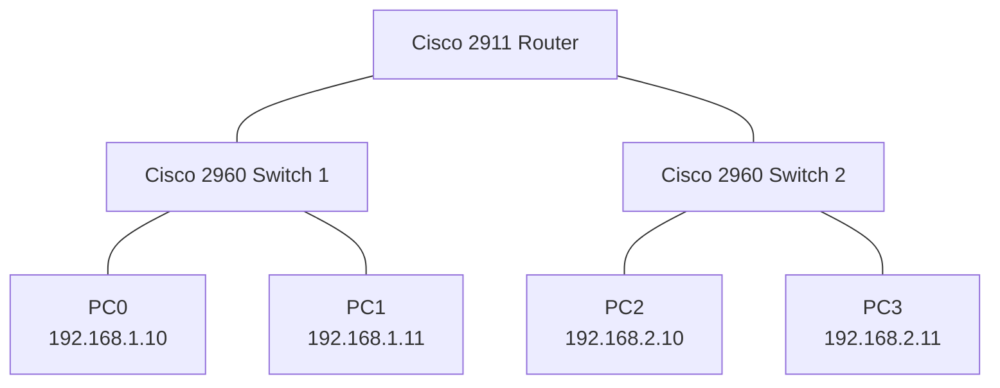

# Small Office Network Design, Configuration and Troubleshooting

## 1. Project Overview

This project demonstrates the design, configuration and troubleshooting of a small office network using Cisco Packet Tracer.

The network consists of two separate IPv4 LANs connected through a Cisco 2911 router. Each LAN contains a Cisco 2960 switch and two end-user computers.

The main objective was to establish communication between different subnets, configure router interfaces and practise diagnosing common network connectivity problems.

## 2. Technologies and Equipment

**Simulation Software**
- Cisco Packet Tracer

**Networking Devices**
- 1 × Cisco 2911 Router
- 2 × Cisco Catalyst 2960 Switches
- 4 × End-user PCs

**Networking Concepts**
- IPv4 addressing
- Subnet masks and CIDR
- Default gateways
- Ethernet switching
- Inter-network routing
- ARP (Address Resolution Protocol)
- ICMP (Internet Control Message Protocol)
- Cisco IOS CLI

## 3. Network Architecture

The network is divided into two IPv4 subnets:

- Administration LAN: `192.168.1.0/24`
- IT Support LAN: `192.168.2.0/24`

The Cisco 2911 router connects both networks.

### Network Topology



## 4. IP Addressing Configuration

All computers were configured manually with static IPv4 addresses.

| Device | IPv4 Address | Subnet Mask | Default Gateway |
|---|---|---|---|
| PC0 | 192.168.1.10 | 255.255.255.0 | 192.168.1.1 |
| PC1 | 192.168.1.11 | 255.255.255.0 | 192.168.1.1 |
| PC2 | 192.168.2.10 | 255.255.255.0 | 192.168.2.1 |
| PC3 | 192.168.2.11 | 255.255.255.0 | 192.168.2.1 |

### Router Interface Configuration

| Router Interface | IPv4 Address | Subnet Mask |
|---|---|---|
| GigabitEthernet0/0 | 192.168.1.1 | 255.255.255.0 |
| GigabitEthernet0/1 | 192.168.2.1 | 255.255.255.0 |

## 5. Cisco Router Configuration

The router was configured using the Cisco IOS Command Line Interface (CLI).

### Configure GigabitEthernet0/0

```text
enable
configure terminal
interface GigabitEthernet0/0
ip address 192.168.1.1 255.255.255.0
no shutdown
exit
```

### Configure GigabitEthernet0/1

```text
interface GigabitEthernet0/1
ip address 192.168.2.1 255.255.255.0
no shutdown
exit
```

### Verify Interface Status

```text
end
show ip interface brief
```

Both router interfaces were verified as operational (`up/up`).

### Verify Routing Table

```text
show ip route
```

The router displayed two directly connected networks:

- `192.168.1.0/24`
- `192.168.2.0/24`

The router automatically installed these connected routes.

## 6. Connectivity Testing

Connectivity was verified using the Windows Command Prompt and ICMP ping tests.

### Tests Performed

| Source | Destination | Result |
|---|---|---|
| PC0 | Router 192.168.1.1 | Successful |
| PC0 | PC1 | Successful |
| PC0 | PC2 | Successful |
| PC2 | PC0 | Successful |
| PC3 | PC1 | Successful |

The initial PC0-to-PC2 ping experienced one timeout, followed by three successful replies. A subsequent test achieved 0% packet loss.

This was consistent with an initial ARP address-resolution delay.

## 7. Network Troubleshooting Exercises

Three intentional network faults were introduced, diagnosed and corrected.

### Exercise 1: Incorrect Default Gateway

**Problem:**

PC0 was assigned an incorrect default gateway (`192.168.1.254`).

**Symptoms:**
- PC0 could communicate with PC1 in the same subnet.
- PC0 could not communicate with PC2 in another subnet.

**Diagnosis:**

The default gateway was incorrectly configured.

**Solution:**

Restored the correct default gateway:

`192.168.1.1`

**Result:** Inter-network connectivity restored.

### Exercise 2: Disabled Router Interface

**Problem:**

The router's GigabitEthernet0/1 interface was intentionally disabled.

**Command used:**

```text
interface GigabitEthernet0/1
shutdown
```

**Symptoms:**
- PC2 could communicate with PC3 locally.
- PC2 could not communicate with PC0.
- The router interface showed an administratively down state.

**Diagnosis:**

The router interface had been manually disabled.

**Solution:**

```text
interface GigabitEthernet0/1
no shutdown
```

**Result:** The interface returned to `up/up`, and inter-network communication was restored.

### Exercise 3: Incorrect Subnet Mask

**Problem:**

PC2's subnet mask was changed from `255.255.255.0` to `255.255.0.0`.

**Symptoms:**
- PC2 could communicate with PC3.
- PC2 could not communicate with PC0.

**Diagnosis:**

The incorrect `/16` subnet mask caused PC2 to incorrectly consider the destination PC0 part of its local network.

**Solution:**

Restored the correct subnet mask:

`255.255.255.0`

**Result:** Inter-network connectivity restored.

## 8. Troubleshooting Commands Practised

| Command | Purpose |
|---|---|
| `ipconfig` | Display IP configuration |
| `ping` | Test network connectivity |
| `arp -a` | Display ARP cache |
| `show ip interface brief` | Check router interface status |
| `show ip route` | Display routing table |
| `shutdown` | Administratively disable an interface |
| `no shutdown` | Enable an interface |

## 9. Skills Developed

Through this project, I gained practical experience in:

- Configuring static IPv4 addresses.
- Understanding subnet masks and default gateways.
- Configuring Cisco router interfaces using IOS CLI.
- Understanding directly connected routes.
- Testing connectivity between separate networks.
- Diagnosing network failures using ping and ARP.
- Troubleshooting incorrect gateway and subnet configurations.
- Identifying and restoring disabled router interfaces.

## 10. Project Conclusion

This project provided practical experience in designing and configuring a basic routed office network.

The network successfully established communication between two separate IPv4 subnets. Three intentional network faults were introduced, diagnosed and corrected.

The project strengthened my understanding of fundamental networking concepts and basic network administration procedures.

## 11. Project Files

- Cisco Packet Tracer simulation: `Packet_Tracer/Small_Office_Network_Final.pkt`
- Network screenshots: `Screenshots/`
- Project documentation: `README.md`

---

**Project Type:** Personal Learning Project  
**Simulation Tool:** Cisco Packet Tracer  
**Focus:** Network Configuration, Connectivity Testing and Troubleshooting